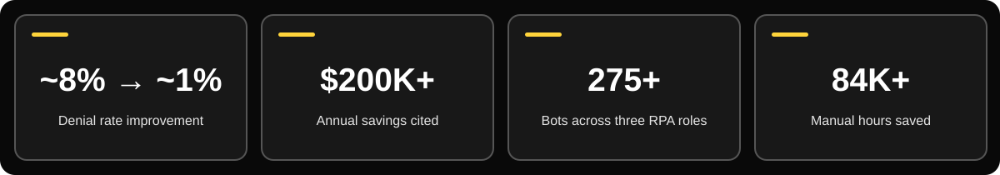
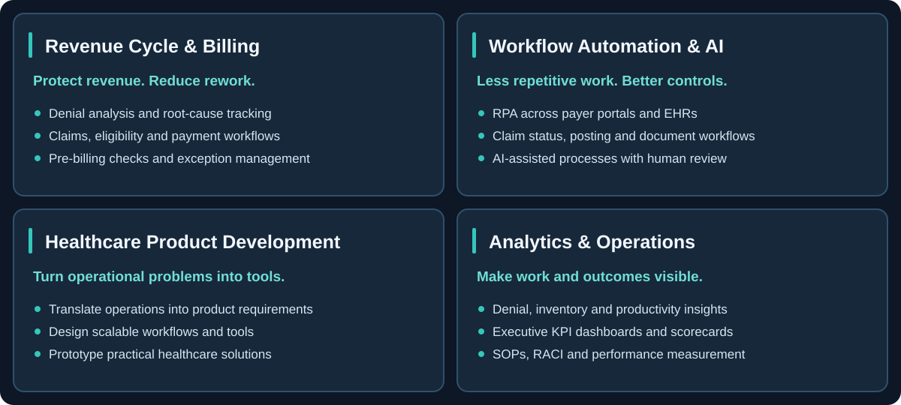

<div align="center">


### Helping home health agencies reduce revenue leakage, manual work & operational friction.

**Revenue Cycle & Automation Consultant** &nbsp;•&nbsp; **Healthcare Operations** &nbsp;•&nbsp; **Home Care & HCBS**

[](https://www.linkedin.com/in/ShyamSundarShankar)
[](mailto:shyam.dragon89@gmail.com)
[](https://github.com/ShyamSundarShankar?tab=repositories)

</div>

<br>

## 👋 About me

I’m **Shyam Sundar Shankar**, a healthcare revenue cycle and automation consultant. I help home health agencies simplify billing, reduce operational friction, and build repeatable systems across people, processes, and technology.

My background spans **healthcare analytics, revenue cycle operations, RPA development, automation leadership, and product thinking**. I have built reporting workflows, developed automation solutions across EHRs and payer portals, and led teams connecting operational insights to automation priorities.

Today, my focus includes **Minnesota home care and HCBS organizations** supporting **245D, PCA/CFSS, and assisted living** workflows.

<br>

## 📈 Selected results



<sub>Denial and annual savings figures are stated in my LinkedIn headline. Bot and hours totals aggregate reported outcomes across three historical RPA roles; they are not annual totals.</sub>

## 🎯 Problems I focus on

Four connected capabilities applied to healthcare operational challenges.



## 🧭 Experience behind the work

| Experience | Selected contributions |
|:--|:--|
| **MBW RCM · RPA & Analytics Leadership** | Built an integrated automation and analytics department; led five people; reported 100+ bots, 33K+ hours saved and ~$65K savings |
| **AGS Health · RPA Team Leadership** | Led eight developers working across AR, charge posting and payment posting; reported 100+ bots and 16K+ hours saved |
| **AGS Health · RPA Development** | Developed 75+ bots, including appeal-letter and refund-packet automation; reported 35K+ hours saved |
| **AGS Health · Analytics & MIS** | Built operational dashboards and automated reporting; reported more than 40% reduction in manual reporting time |

<sub>Selected historical roles and reported outcomes from my LinkedIn profile; this is not a complete employment history.</sub>

<br>

## 🏥 Healthcare domains

<div align="center">


</div>

<br>

## 🛠️ What I'm building and exploring

| Initiative | Focus |
|:--|:--|
| **HCBS Pre-Billing Readiness** | Checklists and rules that surface potential billing issues before submission |
| **Revenue Cycle Workflow Tools** | Organizing tasks, exceptions, and handoffs across billing operations |
| **AI-Assisted Healthcare Operations** | Responsible automation of administrative workflows with human oversight |
| **Operational Analytics** | Making process performance and improvement opportunities visible |

<sub>These describe work and areas of exploration; not every initiative is published as an open-source repository.</sub>

<br>

## 🧰 Tools & technical interests

<div align="center">


</div>

<div align="center">

**AI workflows** · **Process automation** · **API integrations** · **Data analytics** · **Healthcare product design**

</div>

<br>

## 🔍 My approach

```text
Understand the workflow
        ↓
Identify friction and failure points
        ↓
Simplify and standardize
        ↓
Build or automate what matters
        ↓
Measure results and improve
```

<br>

<div align="center">

### Let's build better healthcare workflows.

I work with healthcare teams on revenue cycle improvement, process automation, operational analytics, and practical product development.

[](https://www.linkedin.com/in/ShyamSundarShankar)
[](mailto:shyam.dragon89@gmail.com)


</div>
