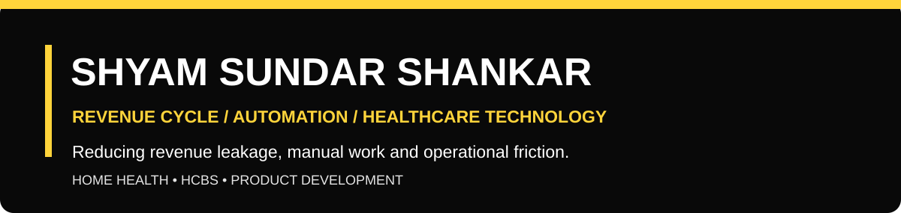
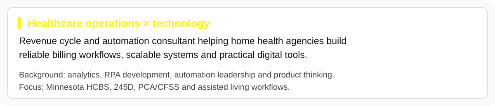
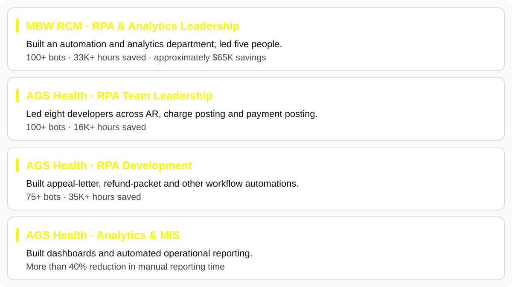
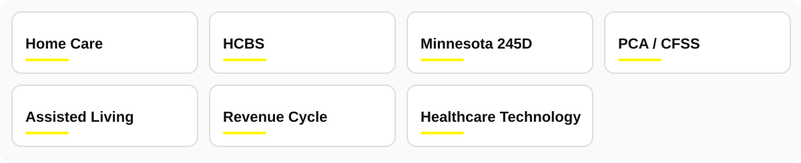
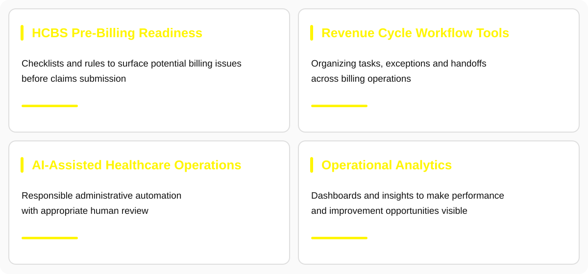
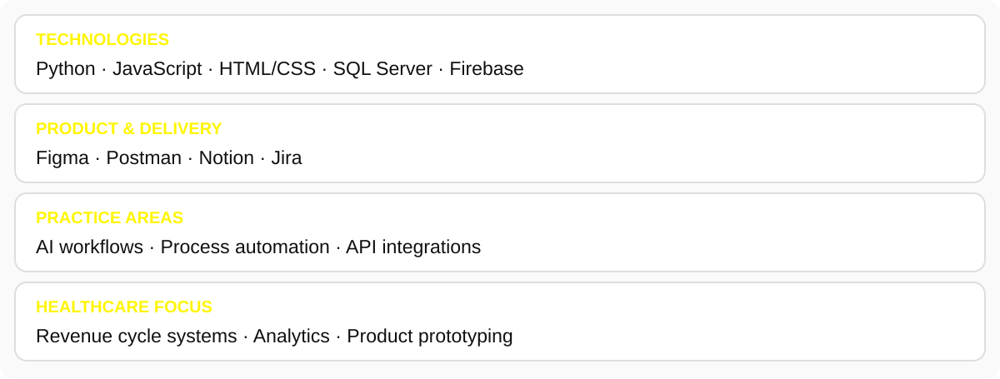
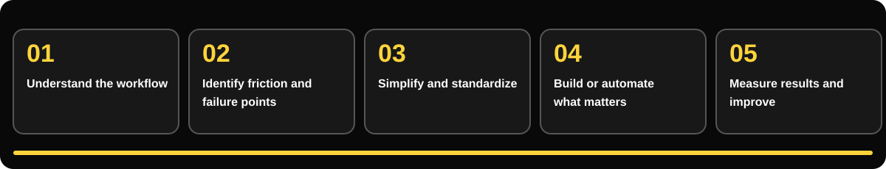
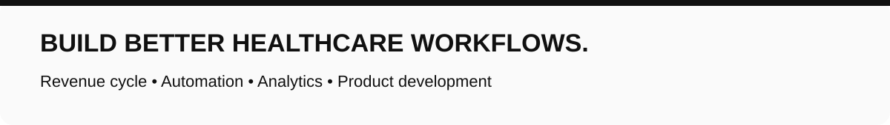

**Helping home health agencies reduce revenue leakage, manual work and operational friction.**

## About me

## Selected results

Denial and annual savings figures are stated in my LinkedIn headline. Bot and hours totals aggregate reported outcomes across three historical RPA roles; they are not annual totals.

## Problems I focus on

## Experience behind the work

Selected historical roles and reported outcomes from my LinkedIn profile; this is not a complete employment history.

## Healthcare domains

## What I'm building and exploring

These describe work and areas of exploration; not every initiative is published as an open-source repository.

## Tools and technical interests

## My approach

